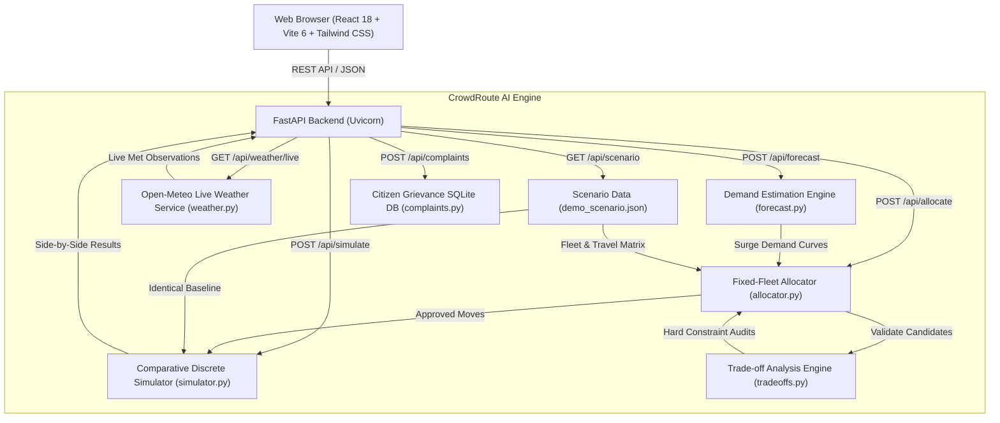
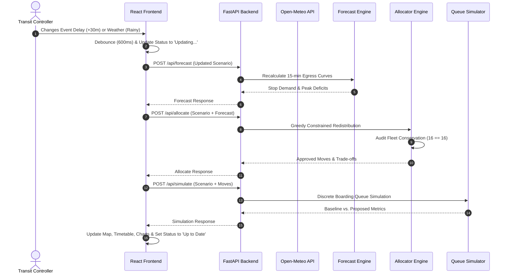

# CrowdRoute AI 🚌⚡
**Festival Crowd Prediction and Fixed-Fleet Bus Optimization**  
**Hackathon:** SAKTHI HACKFEST'26 — Generative AI / Public Transit Domain  
**Target Platform:** Windows 11 | AMD Ryzen 5 | Python 3.12 | FastAPI | React 18 | Vite 6 | TypeScript  
**Repository:** [https://github.com/Maithreyancs/CrowdRoute-AI.git](https://github.com/Maithreyancs/CrowdRoute-AI.git)
**project demo link:**(https://crowdroute-ai-51mj-livid.vercel.app/)

---

> [!WARNING]
> **SYNTHETIC DEMO DATA & SIMULATION DISCLAIMER**  
> All passenger numbers, crowd egress distributions, road transit durations, and bus capacity estimates in this project are strictly **SYNTHETIC PLANNING ESTIMATES**. They are designed for transparent scenario planning, algorithmic evaluation, and hackathon demonstration. Never use these models for real-world life-critical transit dispatch, traffic policing, or physical passenger safety operations.

---

## 1. Executive Summary & Problem Statement

On the closing night of a major regional temple festival (such as the Karthigai Deepam festival in Tiruvannamalai, Tamil Nadu), approximately **40,000 devotees** depart the venue within a concentrated **two-to-three-hour window** (21:00 to 23:30).

- **The Real-World Bottleneck:** The Central Bus Terminal (`STOP_MAIN`), located within 400 metres of the main temple gate, experiences severe crowd surges and platform queues exceeding 2,500 people within 30 minutes of the final ceremony. Meanwhile, only two kilometres away at the North Bypass Ring Stand (`STOP_PERIPHERAL`), multiple buses sit waiting with virtually zero passengers.
- **The Core Constraint (Constraint 2):** **The bus fleet is strictly fixed.** The transit authority cannot magically conjure extra buses or deploy off-grid vehicles during an active egress rush. Every recommendation may **only redistribute existing buses** and must explicitly quantify the donor-stop service reduction and guarantee minimum safety reserves.
- **Key Operational Insights:**
  - *Insight 1:* Festival programmes, ceremony conclusion times, and meteorological forecasts are known in advance, enabling proactive advance staging.
  - *Insight 2:* Moving one bus to the right stand before the crowd peak occurs provides more relief than dispatching ten buses that arrive after passengers have dispersed or crushed the platform.

CrowdRoute AI provides an explainable, deterministic rule-based demand forecasting and fixed-fleet optimization system that respects operational safety constraints, provides transparent trade-offs, and quantifies donor-stop service impacts.

---

## 2. Project Objectives & Target Users

1. **Advance Planning:** Forecast festival egress demand curves across 15-minute intervals based on scheduled ceremony conclusion times, weather conditions, and transport usage fractions.
2. **Fixed-Fleet Redistribution:** Relocate idle or surplus vehicles to relieve bottleneck terminals under hard operational safety constraints.
3. **Transparent Trade-Off Analysis:** Quantify and display the exact service reduction (initial fleet, remaining fleet, seat capacity drop) at every donor stop.
4. **Reproducible Comparative Simulation:** Simulate passenger queues, road transit, and boarding constraints side-by-side between the baseline schedule and the proposed allocation under identical starting conditions.
5. **Citizen Reporting & Transparency:** Provide a public grievance submission portal with SQLite persistence and privacy masking for crowd reporting.

**Target Users:**
- State Transport Corporation (TNSTC) Operations Controllers.
- District Police & Crowd Safety Management Teams.
- Festival Transit Planning Committees.
- Traveling Citizens & Devotees.

---

## 3. Key Features

- **Strict Fixed-Fleet Invariant (Constraint 2):** $N$ buses configured = $N$ buses accounted for ($16 = 16$). Zero phantom buses created, zero buses lost, and zero double-allocations.
- **Live Festival Operations Controller (Constraint 1):** Real-time operational adjustments (Clear, Cloudy, Rainy, Heavy Rain, On Schedule, +15m, +30m, +60m delays, Rain Started). Triggers automatic asynchronous recalculation of demand curves and bus redeployments with out-of-order request sequence protection.
- **Real-Time Live Weather Integration (Open-Meteo):** Integrates live ground meteorological observations for Tiruvannamalai (`12.2253° N, 79.0747° E`) via Open-Meteo with 10-minute caching, HTTP error handling, and offline fallback.
- **Interactive 3-Column Bus Map GIS:** Real-time Leaflet OpenStreetMap rendering with administrative hierarchy controls, layer toggles, crowd-risk stop markers, bus markers, schematic relocation corridors, and deep navy capacity metrics.
- **Operational Bus Timetable:** Clear 12-hour AM/PM departure and arrival times, travel durations (handling midnight crossing), destination benefits, and source minimum service compliance.
- **Comprehensive Festival Scenario Editor:** Configure festival name, expected attendance, event start/end dates and times, delay minutes, timezone, public transit fraction, forecast horizon (24/48/72h), and stop demand shares.
- **Citizen Grievance & Complaint Portal:** Report issues (Overcrowding, Bus Delay, Long Waiting Time, Wheelchair Access) with automated reference ID generation (`CR-2026-XXXX`), status tracking, and privacy masking.
- **Discrete Interval Boarding Simulation:** Side-by-side comparative simulation quantifying queue length reductions and wait time improvements.

---

## 4. System Architecture



---

## 5. End-to-End Data Flow



---

## 6. Technology Stack

| Layer | Component | Version | Role in CrowdRoute AI |
| :--- | :--- | :--- | :--- |
| **Backend** | Python | 3.12.10 | Core programming language runtime. |
| **Backend** | FastAPI | 0.115.6 | Asynchronous REST API framework. |
| **Backend** | Uvicorn | 0.32.1 | High-concurrency ASGI web server. |
| **Backend** | Pydantic | 2.10.4 | Strict domain modeling, validation, and serialization. |
| **Backend** | Pytest | 9.1.1 | Unit, constraint, and API regression testing. |
| **Backend** | HTTPX | 0.28.1 | Asynchronous HTTP client for live Open-Meteo weather and tests. |
| **Backend** | SQLite3 | Built-in | Zero-configuration database for citizen complaints (`complaints.db`). |
| **Frontend** | React | 18.3.1 | Component-based UI library. |
| **Frontend** | TypeScript | 5.6.3 | Static type checking and schema contracts. |
| **Frontend** | Vite | 6.4.4 | Ultra-fast frontend build tooling and dev server. |
| **Frontend** | Tailwind CSS | 3.4.16 | Utility-first styling with custom scroll and animations. |
| **Frontend** | Leaflet | 1.9.4 | Open-source interactive map rendering with OpenStreetMap tiles. |
| **Frontend** | Recharts | 2.13.3 | Responsive SVG data visualization for demand curves. |
| **Frontend** | Lucide React | 0.460.0 | High-contrast iconography. |

---

## 7. Project Directory Structure

```text
CrowdRoute AI/
├── backend/
│   ├── app/
│   │   ├── __init__.py
│   │   ├── main.py              # FastAPI application and route declarations
│   │   ├── models.py            # Pydantic schemas, validation, and domain contracts
│   │   ├── forecast.py          # Rule-based Gaussian demand prediction engine
│   │   ├── allocator.py         # Constrained greedy fixed-fleet reallocation engine
│   │   ├── tradeoffs.py         # Hard constraint gates and dual-sided impact audit
│   │   ├── simulator.py         # Discrete interval queue and boarding simulator
│   │   ├── weather.py           # Real-time Open-Meteo live weather service with cache
│   │   ├── complaints.py        # SQLite citizen grievance persistence and lookup
│   │   ├── historical.py        # Historical CSV/Excel file validation and ingestion
│   │   └── live_data.py         # External telemetry status checker
│   ├── data/
│   │   ├── demo_scenario.json   # Reproducible 16-bus baseline scenario
│   │   └── complaints.db        # SQLite database for citizen reports
│   ├── tests/
│   │   ├── test_all.py          # Baseline test suite
│   │   ├── test_api.py          # REST API endpoint tests
│   │   ├── test_complaints.py   # Complaint submission and tracking tests
│   │   ├── test_constraints.py  # Fleet conservation and constraint tests
│   │   ├── test_dynamic.py      # Weather surge and delay shift tests
│   │   ├── test_portal_improvements.py # Portal regression tests
│   │   └── test_weather_and_scenario.py # Live weather and scenario input tests
│   └── requirements.txt         # Backend Python dependencies
├── frontend/
│   ├── src/
│   │   ├── components/
│   │   │   ├── AdministrativeStepBar.tsx # Step 1-4 hierarchy filter bar
│   │   │   ├── BusAllocation.tsx         # Suggested bus changes & trade-offs
│   │   │   ├── BusMap.tsx                # 3-column GIS Leaflet bus map
│   │   │   ├── BusMovementImpact.tsx     # Fleet conservation audit & impact breakdown
│   │   │   ├── BusTimetable.tsx          # 12-hour AM/PM bus deployment timetable
│   │   │   ├── CivicModals.tsx           # Report Problem and Track Grievance modals
│   │   │   ├── ComplaintSection.tsx      # Public complaints submission & feed
│   │   │   ├── CrowdForecast.tsx         # Crowd demand forecast overview
│   │   │   ├── DataSourceStatus.tsx      # Telemetry feed provenance card
│   │   │   ├── DemandChart.tsx           # Recharts demand and carrying capacity graph
│   │   │   ├── ErrorBoundary.tsx         # React Error Boundary with safe reset
│   │   │   ├── Footer.tsx                # Government portal footer
│   │   │   ├── Header.tsx                # Two-tier header with civic quick action sub-bar
│   │   │   ├── HeroSection.tsx           # Aerial transport hero section with dual CTAs
│   │   │   ├── HistoricalUpload.tsx      # Past crowd CSV/Excel drag-and-drop upload
│   │   │   ├── LiveFestivalUpdates.tsx   # Live operations controller (weather & delays)
│   │   │   ├── ScenarioForm.tsx          # Comprehensive scenario & fleet editor
│   │   │   ├── SimulationComparison.tsx  # Side-by-side boarding queue simulation
│   │   │   └── SummaryMetrics.tsx        # 4-card metric strip & live telemetry bar
│   │   ├── pages/
│   │   │   ├── DashboardPage.tsx         # Operations controller dashboard with 7 tabs
│   │   │   ├── DataSourcesPage.tsx       # Data sources and provenance page
│   │   │   └── HomePage.tsx              # Portal home page
│   │   ├── services/
│   │   │   └── api.ts                    # Typed API client
│   │   ├── types/
│   │   │   └── api.ts                    # TypeScript domain interfaces
│   │   ├── utils/
│   │   │   ├── chartData.ts              # Demand chart data transformations
│   │   │   └── timeFormat.ts             # 12-hour AM/PM parsing and duration utilities
│   │   ├── App.tsx                       # Root application component with routing
│   │   ├── index.css                     # Tailwind CSS, smooth scrolling, scroll margins
│   │   └── main.tsx                      # Vite React entry point
│   ├── package.json                      # Frontend dependencies and npm scripts
│   ├── test-chart.js                     # Chart data transformation test suite
│   ├── test-constraints.js               # Constraint 1 & 2 test suite
│   └── test-time.js                      # Time parsing and duration test suite
├── .env.example                          # Environment variable configuration template
├── .gitignore                            # Git exclusion rules
└── README.md                             # Comprehensive documentation (this file)
```

---

## 8. Prerequisites & Installation

### Prerequisites
- **Operating System:** Windows 10/11, macOS, or Linux.
- **Python:** Python 3.11 or 3.12 (Python 3.12.10 recommended).
- **Node.js:** Node.js v18+ and npm v9+ (Node 20/22 recommended).
- **Git:** Git version 2.30+.

### Step 1: Clone the Repository
```powershell
git clone https://github.com/jayakumarcyber/CrowdRoute-AI.git
cd "CrowdRoute-AI"
```

### Step 2: Setup Python Backend Environment
```powershell
# Create Python virtual environment
python -m venv .venv

# Activate virtual environment (PowerShell)
.\.venv\Scripts\Activate.ps1
# (Or on CMD: .\.venv\Scripts\activate.bat)
# (Or on Linux/macOS: source .venv/bin/activate)

# Upgrade pip and install dependencies
python -m pip install --upgrade pip
pip install -r backend\requirements.txt
```

### Step 3: Setup React Frontend Environment
```powershell
cd frontend
npm install
cd ..
```

---

## 9. How to Run the Project Locally

You will run the backend and frontend in two separate terminal windows.

### Terminal 1: Start the Python FastAPI Backend
```powershell
cd "D:\CrowdRoute AI"
.\.venv\Scripts\Activate.ps1
python -m uvicorn backend.app.main:app --host 127.0.0.1 --port 8000 --reload
```
- **Backend API Base:** `http://127.0.0.1:8000`
- **Interactive Swagger Docs:** `http://127.0.0.1:8000/docs`
- **Redoc Documentation:** `http://127.0.0.1:8000/redoc`
- **Health Check Endpoint:** `http://127.0.0.1:8000/health`

### Terminal 2: Start the React + Vite Frontend
```powershell
cd "D:\CrowdRoute AI\frontend"
npm run dev
```
- **Frontend URL:** `http://localhost:5173/`

Open your web browser and navigate to `http://localhost:5173/`.

---

## 10. Environment Variables & Configuration

Create a `.env` file in the project root if custom URLs are needed:
```env
# Optional external telemetry configuration (defaults to open public feeds)
LIVE_WEATHER_API_URL=
WEATHER_API_KEY=
GTFS_REALTIME_FEED_URL=
PORT=8000
HOST=127.0.0.1
```
*Note: Real-time weather uses Open-Meteo which requires **zero API keys** and operates out-of-the-box.*

---

## 11. Verified API Endpoints

| Method | Endpoint | Description |
| :--- | :--- | :--- |
| `GET` | `/health` | System health, service status, and operational mode metadata. |
| `GET` | `/api/scenario` | Returns the active baseline festival scenario (stops, fleet, matrix). |
| `POST` | `/api/validate/scenario` | Validates user-defined scenario fields. |
| `GET` | `/api/weather/live` | Real-time meteorological telemetry for Tiruvannamalai from Open-Meteo. |
| `GET` | `/api/live/status` | Live data telemetry status report for external feeds. |
| `POST` | `/api/forecast` | Computes 15-minute crowd egress forecasts per stop. |
| `POST` | `/api/allocate` | Evaluates candidates and returns safe fixed-fleet relocations. |
| `POST` | `/api/simulate` | Side-by-side queue simulation comparing baseline vs. proposed schedules. |
| `POST` | `/api/complaints` | Submits a citizen transport complaint into SQLite storage. |
| `GET` | `/api/complaints` | Returns recent public complaints with citizen phone/email masked. |
| `GET` | `/api/complaints/{reference_id}` | Tracks complaint status by reference ID (e.g. `CR-2026-FD4A8`). |
| `POST` | `/api/historical/upload` | Validates and ingests historical passenger CSV/Excel files. |
| `GET` | `/api/historical/sample` | Downloads sample historical festival passenger CSV. |

---

## 12. Crowd Prediction Methodology

The crowd demand forecasting engine (`backend/app/forecast.py`) uses a transparent, rule-based **Gaussian distribution model**:

1. **Total Egress Calculation:**  
   $$\text{Total Egress Passengers} = \text{Expected Attendance} \times \text{Transit Fraction}$$
   *(e.g., $40,000 \times 0.85 = 34,000\text{ passengers})$*

2. **Temporal Distribution:**  
   Passenger departures across 15-minute intervals follow a normal (Gaussian) distribution centered on the scheduled event conclusion time:
   $$w_i = \exp\left( -\frac{(t_i - \mu)^2}{2\sigma^2} \right)$$
   where:
   - $\mu$ = Scheduled event conclusion time (e.g., 21:30).
   - $\sigma$ = Standard deviation (default 35 minutes).
   - If weather is **Rainy** or **Heavy Rain**, $\sigma$ compresses (concentration factor $1.2\times$ to $1.4\times$), causing crowds to leave more urgently in a narrower time window.

3. **Stop Allocation:**  
   Demand for interval $i$ at stop $s$ is computed as:
   $$\text{Demand}_{s, i} = \text{Total Egress} \times \text{Normalized Weight}_i \times \text{Stop Share}_s$$

4. **Deficit / Surplus Determination:**  
   $$\text{Deficit}_{s, i} = \max(0, \text{Demand}_{s, i} - \text{Scheduled Capacity}_{s, i})$$

> **Transparency Note:** CrowdRoute AI uses deterministic, verifiable mathematical rules rather than unvalidated black-box neural networks. This guarantees reproducible, explainable results for transit operators.

---

## 13. Fixed-Fleet Bus Allocation Algorithm & Constraint Gates

The allocator (`backend/app/allocator.py` & `backend/app/tradeoffs.py`) applies a constrained greedy heuristic subject to **7 strict operational safety gates**:

1. **Gate 1 (Fleet Conservation):** Total initial fleet count must strictly equal total final fleet count ($\sum \text{buses}_{\text{initial}} = \sum \text{buses}_{\text{final}} = 16$).
2. **Gate 2 (Bus Availability):** A bus can only be relocated if its operational status is `"available"`.
3. **Gate 3 (No Duplicate Relocation):** A bus cannot be relocated twice in the same planning batch.
4. **Gate 4 (Route Compatibility):** The bus must be authorized to serve the destination stop.
5. **Gate 5 (Timely Arrival):** The relocated bus must depart and arrive at the destination *before* the target crowd peak begins:
   $$\text{Departure Time} + \text{Travel Time} \le \text{Peak Window Start}$$
6. **Gate 6 (Donor Stop Minimum Service):** A bus cannot be taken from a stop if the remaining buses would fall below that stop's configured safety baseline:
   $$\text{Buses Remaining at Source} \ge \text{Min Service Buses}$$
7. **Gate 7 (Net System Benefit):** The passenger capacity relief at the destination must exceed the service impact at the source stop.

If no movement can pass all 7 gates, the system outputs `NO_SAFE_MOVE` with clear explanations instead of dispatching unsafe buses.

---

## 14. Step-by-Step Hackathon Demo Walkthrough

### Scenario A: Normal Operations Baseline
1. Open `http://localhost:5173/`.
2. Notice the two-tier navigation with the badge **"VERIFIED 16-BUS FLEET CONSERVED"**.
3. View the 4-card metric strip: **16 Fixed Fleet Buses**, **34,000 Expected Passengers**, **16/16 Conserved**, **15/30/60m Horizons**.
4. Scroll to the **Interactive Bus Map**: observe the 3-column GIS layout with stop markers, positioned buses, and the deep navy capacity panel.

### Scenario B: Event Delay (+30 Minutes)
1. In the **Live Operations Controller** panel, click **"+30 Minutes"** or **"Final Event Delayed +30 Minutes"**.
2. Notice the status pill updates to **"Updating..."** and then **"Up to Date"**.
3. The peak departure window automatically shifts from `21:30` (9:30 PM) to `22:00` (10:00 PM).
4. Demand curves, bus allocation recommendations, and the timetable update without requiring a page reload.

### Scenario C: Sudden Monsoon Rain
1. Click **"Rain Started"** or toggle weather to **"Heavy Rain"**.
2. The weather multiplier compresses crowd departure urgency ($1.4\times$ factor).
3. The risk indicator for `STOP_MAIN` escalates to **CRITICAL**, and the system suggests allocating additional buses from `STOP_PERIPHERAL`.

### Scenario D: Fixed-Fleet Invariant Audit
1. Inspect the **"Suggested Bus Changes & Trade-offs"** section.
2. Confirm the audit badge shows: **"All 16/16 Buses Accounted For (Fixed Fleet Conserved)"**.
3. Review the dual-sided impact:
   - **Donor Stop (`STOP_PERIPHERAL`):** Service reduced from 6 to 5 buses (safely above the minimum reserve of 2).
   - **Destination Stop (`STOP_MAIN`):** Gains $+60$ passenger capacity during the peak rush.

### Scenario E: Time Input & Error Handling
1. In the Live Operations Controller, enter `12:19 pm` in the custom time box and click **"Set Time"**.
2. The system cleanly accepts and parses the civilian time format into `12:19 PM`.
3. Enter `99:99` or text: the system displays a clear, helpful error message.
4. Click **"Reset to Scenario Defaults"**: the system restores the 9:30 PM schedule and Clear weather.

### Scenario F: Citizen Grievance Reporting & Tracking
1. Click the red button **"Report Problem"** in the top action bar.
2. Select `STOP_MAIN`, category `Overcrowding`, and submit a report.
3. The modal displays the generated reference ID (e.g., `CR-2026-FD4A8`).
4. Click **"Track Report"**, enter `CR-2026-FD4A8`, and click **"Track"**: the modal displays the persisted record from SQLite with status `Received`.

---

## 15. Automated Verification & Testing

### 1. Run Backend Python Tests (53 tests)
```powershell
.\.venv\Scripts\python.exe -m pytest backend/tests
```
**Result:** **53 passed in ~1.2s**
- `test_all.py`: 15 passed
- `test_api.py`: 6 passed
- `test_complaints.py`: 4 passed
- `test_constraints.py`: 5 passed
- `test_dynamic.py`: 11 passed
- `test_portal_improvements.py`: 8 passed
- `test_weather_and_scenario.py`: 4 passed

### 2. Run Frontend Unit & Constraint Tests
```powershell
cd frontend
npm test
```
**Result:** **All 3 test suites passed**
- `test-chart.js`: Chart bounds, high-demand calculations, filtering.
- `test-constraints.js`: Out-of-order response sequencing, event delays, 16-bus conservation invariant.
- `test-time.js`: 12-hour AM/PM parsing, 24-hour validation, midnight crossing duration.

### 3. Run Frontend Production Build Check
```powershell
cd frontend
npm run build
```
**Result:** **0 TypeScript errors**, compiled cleanly with Vite in 9.4s.

---

## 16. Current Limitations & Planned Improvements

- **Road Routing:** Bus transfer corridors are currently rendered as schematic direct paths between stands. Integration with OpenStreetMap OSRM routing engine is planned for real street navigation.
- **GPS Telemetry:** Bus locations represent depot and terminal stationing rather than live physical AVL GPS pings.
- **Fleet Scale:** The baseline demonstration scenario models 16 buses across 3 stands; scalability testing for 200+ buses across 50 stops is in progress.

---

## 17. Team & Hackathon Details

- **Event:** SAKTHI HACKFEST'26  
- **Team Name:** TEAM INNOVATORS  
- **Domain:** Generative AI & AI-Driven Urban Decision Support Systems  
- **Venue:** Sakthi Institute of Engineering and Technology, Tamil Nadu  
- **Project Lead & Developer:** Jayakumar R. ([@jayakumarcyber](https://github.com/jayakumarcyber))

---

## 18. License

This project is licensed under the MIT License — see the [LICENSE](LICENSE) file for details.
